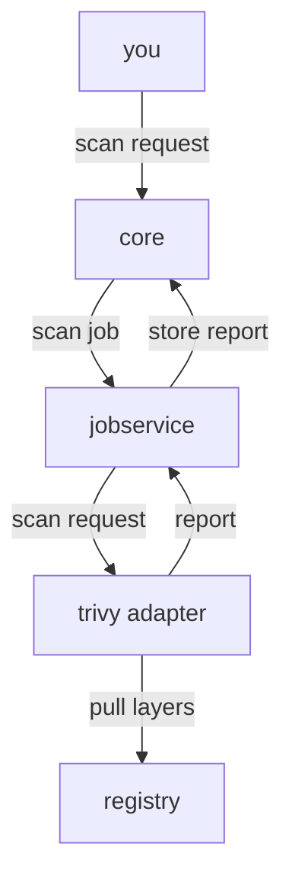

# How Harbor Scans Artifacts With Trivy

Before you trust a vulnerability report, you need to know which program wrote it and what it compared your artifact with. A scan in Harbor is not one program. It is a request that passes through several Harbor components, a scanner that reads the artifact's layers, and a database that changes every few hours. This part follows one scan through all of them, so that a failed or surprising scan later has an obvious place to look.

## The components that take part in a scan

Harbor runs as a set of components, and each one has one job. Four of them take part in every scan. Look at them first, on your machine:

<!-- astrona:playground:renew -->

```sh
kubectl -n harbor get pods
```

The list shows one pod per component: `harbor-core`, `harbor-jobservice`, `harbor-registry`, `harbor-trivy`, `harbor-database`, `harbor-redis`, `harbor-portal` and `harbor-nginx`. Each pod name starts with the Helm release name `harbor`, and the random suffix differs on your cluster. Every pod should be `Running` and ready.

Four of these components work together when you ask for a scan:

| Component | What it does in a scan |
| --- | --- |
| `core` | Harbor's API server. It accepts the scan request, checks your permission, and stores the report when it arrives |
| `jobservice` | Runs background jobs. It turns the request into a scan job and calls the scanner |
| `trivy` | The Trivy adapter: a small service that receives the job, runs Trivy and returns the report |
| `registry` | Stores the artifact's layers. The Trivy adapter pulls them from here to look inside |

The order matters when something fails, so here it is as a flow:



The diagram shows a request travelling from `core` to `jobservice` to the Trivy adapter, the adapter reading the layers from `registry`, and the report travelling back to `core`, which saves it in the PostgreSQL `database`.

Two facts follow from this flow. A scan is a background job, so the request returns at once and the report arrives later. And if the `trivy` pod is not running, the job still starts but cannot finish, so the scan ends in an error.

## Ask Harbor which scanner it uses

Harbor can work with more than one scanner. It keeps a list of **scanner registrations**, and one of them is the default for every project. The `harbor` command-line tool can show that list. It is the Harbor command-line tool from the `goharbor/harbor-cli` project, and it calls the same REST API v2.0 that the web portal uses.

Open a shell in the workstation on your machine:

```sh
kubectl -n workstation exec -it deploy/workstation -- sh
```

In the workstation shell, sign the command-line tool in to Harbor. The `--context-name` flag saves the server, the user and the password as a named **context** in the tool's configuration file, so later commands need no password:

```sh
harbor login https://harbor.localtest.me:8443 --username admin --password Harbor12345 --context-name lab-admin
```

The tool encrypts the password before it saves it. The workstation has no system keyring, so the tool prints a warning that it falls back to a file-based keyring in the home directory; in a lab that is fine. Now list the scanners:

```sh
harbor scanner list
```

The table shows one scanner, `Trivy`, marked as the default, with the address of the `harbor-trivy` Service as its endpoint. The Helm chart registered it when Harbor was installed. A registration that comes with Harbor cannot be deleted, but an administrator can add other scanners next to it.

## The Trivy database

Trivy does not know about vulnerabilities by itself. It compares the packages it finds with the **Trivy database**: a file of known vulnerabilities, collected from many public sources and published as an OCI artifact. The Trivy adapter downloads it from `mirror.gcr.io/aquasec/trivy-db`, or from `ghcr.io/aquasecurity/trivy-db` when the first source fails, and keeps a copy in the pod under `/home/scanner/.cache/trivy/db/`. The upstream database is rebuilt every 12 hours, and the adapter downloads a newer copy when its own is out of date.

You can see the copy in the `trivy` pod. On your machine, run:

```sh
kubectl -n harbor exec harbor-trivy-0 -- ls -l /home/scanner/.cache/trivy/db/
```

The folder holds `trivy.db` and a small `metadata.json` that records when the database was built. The playground downloaded it when it scanned one artifact in the project `warmup`. In a brand new Harbor, the first scan has to download it first, so that scan takes noticeably longer.

This has two consequences. The same artifact can get a different report tomorrow, because the database learned about a new CVE overnight. And a Harbor with no internet access cannot download the database at all. For such an air-gapped installation, the chart has the options `trivy.skipUpdate` and `trivy.offlineScan`; an administrator then downloads `trivy.db` elsewhere and mounts it into the pod.

## Check that every component is healthy

When a scan fails, the first question is whether every component is up. Harbor answers it itself through the health endpoint, which needs no sign-in. In the workstation shell, run:

```sh
curl -s https://harbor.localtest.me:8443/api/v2.0/health | jq
```

The JSON has an overall `status` and a list of `components`: `core`, `database`, `jobservice`, `portal`, `redis`, `registry`, `registryctl` and `trivy`, each with its own `status`. In a working Harbor, every one reads `healthy`. If the Trivy adapter is down, the `trivy` entry says `unhealthy` and carries an error, while the rest of Harbor keeps working.

You now know what a scan is: a job that `core` hands to `jobservice`, which calls the Trivy adapter, which reads the layers from `registry` and compares the packages with the Trivy database. You also know where to look when a scan fails: the health endpoint and the `trivy` pod. The open question is what a report looks like, and how to start a scan and read it from the command line.

## Common pitfalls

> [!WARNING]
> - **Expecting a report right after a push.** Harbor scans nothing until something asks it to. A project does not scan new artifacts unless scan on push is turned on.
> - **Treating a report as permanent.** The Trivy database changes every 12 hours, so a clean report from last month says little about today.
> - **Waiting forever on the first scan.** A new Harbor must download the Trivy database first. Without internet access, the scan fails; set up the offline database instead.
> - **Looking only at `core` when a scan fails.** The scan runs in `jobservice` and the `trivy` adapter. The health endpoint shows which one is down.
