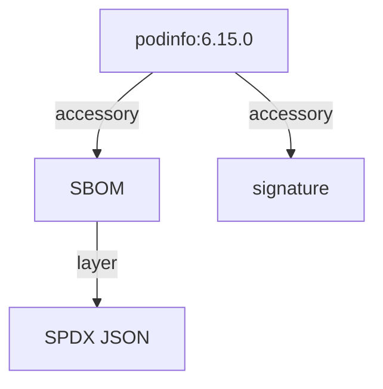

# What An SBOM Is And How Harbor Stores It

Before you generate an SBOM, it helps to know what kind of document you will get and where Harbor will put it. An SBOM is not a report about problems; it is a list of parts. And Harbor does not store it in a database table next to the scan results. It stores it as an artifact of its own, linked to the image it describes. This part explains both, so that the commands that follow have an obvious meaning.

## An SBOM is a list of packages

A **Software Bill of Materials (SBOM)** lists every software package inside an artifact. For each package it records at least the name and the version, and usually more: the license, the package type, and a **package URL (purl)**, a standard string such as `pkg:apk/alpine/zlib@1.2.12-r0` that names the package, its ecosystem and its version in one line.

The difference from a vulnerability report matters in practice:

| | Vulnerability report | SBOM |
| --- | --- | --- |
| Answers | Which known CVEs affect this artifact? | Which packages are in this artifact? |
| Changes over time | Yes, as the vulnerability database learns about new CVEs | No, the packages of an image never change after it is built |
| Typical use | Decide whether to block or fix an image today | Find every image that contains a package when a new flaw is announced; license reviews; audits |

The two work together. A scanner such as Trivy builds its vulnerability report by first listing the packages, the same list an SBOM records, and then looking each one up in the vulnerability database.

## The SPDX format

There are two common SBOM formats: SPDX, from the Linux Foundation, and CycloneDX, from OWASP. Harbor 2.15 produces **SPDX** in its JSON form, with the media type `application/spdx+json`. An SPDX document has a few top-level fields and two long lists:

| Field | What it holds |
| --- | --- |
| `spdxVersion` | The version of the SPDX specification, for example `SPDX-2.3` |
| `name` | The name of the document, usually the image it describes |
| `creationInfo` | When the document was made and by which tool, for example a `Tool: trivy` entry |
| `packages` | One entry per package, with `name`, `versionInfo`, the license fields and `externalRefs` that hold the purl |
| `relationships` | How the entries relate, for example that the image `CONTAINS` an operating system and the operating system `CONTAINS` a package |

You will read these fields with `jq` once Harbor has generated a document. A page of an SPDX document is long but regular, so a short `jq` filter is enough to answer most questions.

## Harbor stores the SBOM as an accessory

Harbor keeps an SBOM in the registry, as an OCI artifact of its own. It links that artifact to the image it describes, its **subject**, and calls it an **accessory**: an artifact that belongs to another artifact and is shown, copied and deleted together with it. Signatures are accessories too.



The diagram shows one image with two accessories: an SBOM, whose only layer is the SPDX JSON document, and a signature. The SBOM accessory has the accessory type `sbom.harbor` and the artifact type `application/vnd.goharbor.harbor.sbom.v1`.

Storing the SBOM as an artifact has useful effects. A replication rule that copies an image to another registry can copy its SBOM too. Deleting the image deletes its SBOM. And any OCI client, not only Harbor, can download the SBOM by its digest.

## Look at an artifact without an SBOM

Before you generate anything, look at how Harbor shows an artifact that has no SBOM, so you can tell the difference later. Open a shell in the workstation on your machine:

<!-- astrona:playground:renew -->

```sh
kubectl -n workstation exec -it deploy/workstation -- sh
```

In the workstation shell, define the API helper and read `podinfo:6.15.0` with its SBOM overview and its accessories:

```sh
API=https://harbor.localtest.me:8443/api/v2.0
api() { curl -fsS -u admin:Harbor12345 -H 'Content-Type: application/json' "$@"; }
api "$API/projects/inventory/repositories/podinfo/artifacts/6.15.0?with_sbom_overview=true&with_accessory=true" \
  | jq '{digest, sbom_overview, accessories}'
```

`sbom_overview` is missing or `null`, and `accessories` is empty or `null`. Nobody has asked Harbor for an SBOM, and nothing is attached to the image.

The same is true of the project settings. Read them:

```sh
api "$API/projects/inventory" | jq .metadata
```

The metadata has no `auto_sbom_generation` key set to `"true"`, so a new push to `inventory` gets no SBOM either. That key is the switch for SBOM generation on push.

You now know what an SBOM is, which format Harbor writes, and where Harbor keeps it: as an accessory of type `sbom.harbor`, linked to its subject image. The open question is how to make Harbor generate one, and how to get the SPDX document back out.

## Common pitfalls

> [!WARNING]
> - **Treating an SBOM as a vulnerability report.** It lists packages; it says nothing about which ones are vulnerable.
> - **Expecting CycloneDX from Harbor.** Harbor 2.15 writes SPDX JSON.
> - **Looking for the SBOM in the scan overview.** It has its own overview, `sbom_overview`, and lives as an accessory with its own digest.
> - **Deleting an image to keep its SBOM.** Accessories are deleted with their subject.
