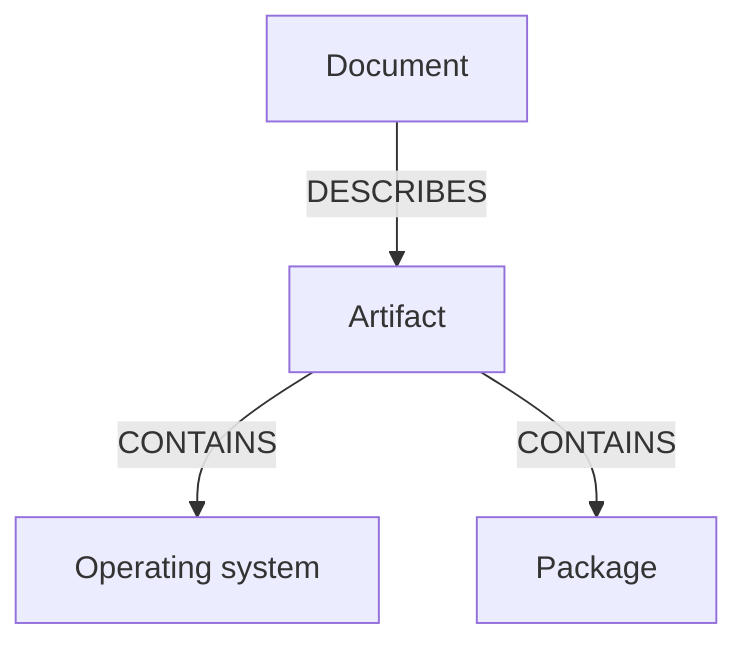

# The Structure Of An SPDX Document

Every question you ask an SBOM is a path through its fields. If you know where the packages, the licenses and the relationships live, a one-line `jq` filter answers most questions. This part makes an SBOM for one artifact, saves it, and walks through its top level before you query it in the next parts.

## Make an SBOM and save it

Harbor generates an SBOM through the same scan endpoint it uses for vulnerability reports. A `POST` with the body `{"scan_type":"sbom"}` asks for an SBOM, and the Trivy adapter writes it as an accessory of the artifact. Open a shell in the workstation on your machine:

<!-- astrona:playground:renew -->

```sh
kubectl -n workstation exec -it deploy/workstation -- sh
```

In the workstation shell, define the helpers, ask for the SBOM of `alpine:3.20`, and follow its status:

```sh
API=https://harbor.localtest.me:8443/api/v2.0
api() { curl -fsS -u admin:Harbor12345 -H 'Content-Type: application/json' "$@"; }
api -X POST "$API/projects/audit/repositories/alpine/artifacts/3.20/scan" -d '{"scan_type":"sbom"}'
api "$API/projects/audit/repositories/alpine/artifacts/3.20?with_sbom_overview=true" | jq '.sbom_overview | {scan_status, sbom_digest}'
```

When `scan_status` reads `Success`, `sbom_digest` holds the digest of the SBOM accessory. Download the document by that digest with `regctl`, which signs in to Harbor first:

```sh
regctl registry login harbor.localtest.me:8443 -u admin -p Harbor12345
SBOM_DIGEST=$(api "$API/projects/audit/repositories/alpine/artifacts/3.20?with_sbom_overview=true" | jq -r '.sbom_overview.sbom_digest')
regctl artifact get "harbor.localtest.me:8443/audit/alpine@$SBOM_DIGEST" > alpine-3.20.spdx.json
```

## The top level of the document

An SPDX document is one JSON object. Print its keys, and then the values of the small fields:

```sh
jq 'keys' alpine-3.20.spdx.json
jq '{spdxVersion, dataLicense, SPDXID, name, documentNamespace, creationInfo}' alpine-3.20.spdx.json
```

The fields have fixed meanings:

| Field | What it holds |
| --- | --- |
| `spdxVersion` | The version of the SPDX specification the file follows |
| `dataLicense` | The license of the document itself, not of the packages |
| `SPDXID` | The identifier of the document, `SPDXRef-DOCUMENT` |
| `name` | The name of the document, taken from the scanned artifact |
| `documentNamespace` | A unique address that identifies this document |
| `creationInfo` | The time of creation and the creators, including the Trivy version |
| `packages` | One entry for every package, and one for the artifact itself |
| `relationships` | The list of links between the entries |

Every package has an `SPDXID`, a local name such as `SPDXRef-Package-...` that the relationships use to point at it.

## The relationships

A flat list of packages does not say how they belong together. The `relationships` list does. Each entry has an `spdxElementId`, a `relatedSpdxElement` and a `relationshipType`. Count the types that occur:

```sh
jq '[.relationships[].relationshipType] | group_by(.) | map({type: .[0], count: length})' alpine-3.20.spdx.json
```

The document uses `DESCRIBES` to link the document to the artifact it describes, and `CONTAINS` to link the artifact, or the operating system, to the packages inside it. Some documents also use `DEPENDS_ON` for a dependency between two packages. Print the first few relationships to see the pattern:

```sh
jq '.relationships[:5]' alpine-3.20.spdx.json
```

Each entry names two identifiers. To read what they stand for, look the identifiers up in the `packages` list by `SPDXID`.



The diagram shows the usual shape: the document describes the artifact, and the artifact contains its packages, directly or through the operating system.

You can now make an SBOM, download it by its digest, and name its fields and relationships. The packages are the part you will use most, and they carry more data than a name and a version.

## Common pitfalls

> [!WARNING]
> - **Reading `dataLicense` as the license of the image.** It is the license of the SBOM file.
> - **Downloading before the status is `Success`.** The digest is empty until the SBOM exists.
> - **Looking only at `packages`.** The links between entries are in `relationships`.
> - **Expecting the same `documentNamespace` for two SBOMs of one image.** Each generated document has its own.
