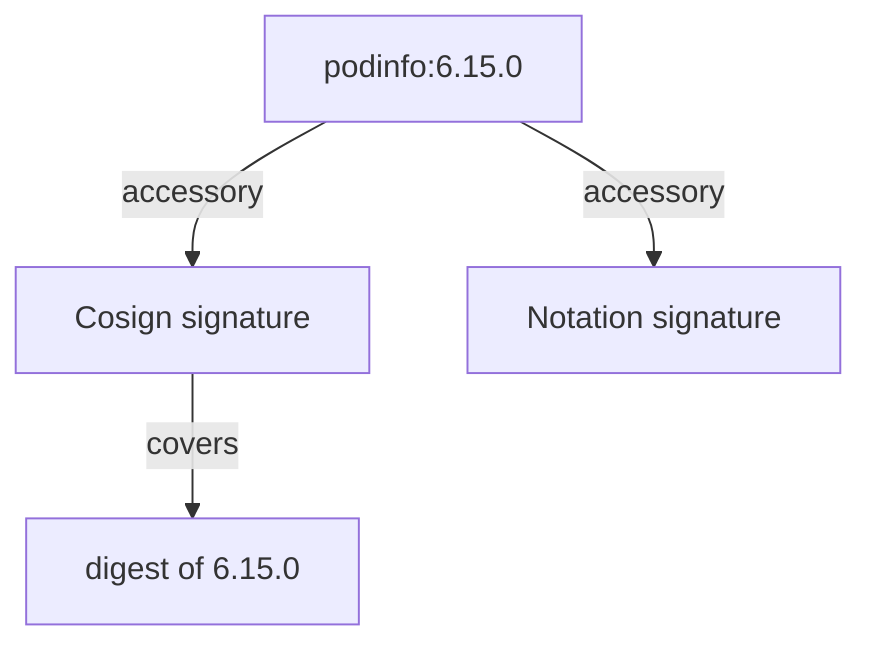

# Signatures, Accessories And Where Notary Went

Before you sign anything, you need to know where a signature ends up and which signing systems Harbor still understands. Older guides talk about Docker Content Trust and a Notary server, and those instructions no longer work with current Harbor. This part explains what replaced them, how Harbor keeps a signature next to the artifact it signs, and which project settings decide whether signatures matter at all.

## A signature is an artifact too

A container signature is a small OCI artifact. It holds the signed digest of another artifact, its **subject**, and the signature itself. Harbor stores it in the same repository as its subject and links the two. Harbor calls such a linked artifact an **accessory**: it is listed, copied by replication and deleted together with its subject.



The diagram shows one image with two accessories, a Cosign signature and a Notation signature, each of which covers the image's digest rather than its tag.

Harbor recognises two kinds of signature accessory. A **Cosign** signature has the accessory type `signature.cosign`. A **Notation** signature, made with the Notary Project's tool `notation`, has the type `signature.notation`. Harbor can also hold an SBOM accessory, with the type `sbom.harbor`, next to them.

## Where Notary went

Harbor 1 and early Harbor 2 shipped a **Notary** server, and clients used **Docker Content Trust (DCT)**: `DOCKER_CONTENT_TRUST=1` made `docker push` sign and `docker pull` check. That design kept signatures in a separate server with its own database. Harbor deprecated Notary in version 2.6.0 and removed it completely in **version 2.9.0**. Harbor 2.15 has no Notary server and does not understand Docker Content Trust.

Two tools replaced it, and both store signatures in the registry itself, as accessories:

| Tool | Project | Keys | Harbor accessory type |
| --- | --- | --- | --- |
| Cosign | Sigstore | A Cosign key pair, a key in a key management service, or keyless signing with a short-lived certificate | `signature.cosign` |
| Notation | Notary Project (CNCF) | X.509 certificates and a trust policy | `signature.notation` |

This course uses Cosign with a key pair. **Keyless signing**, Cosign's default without `--key`, signs with a short-lived certificate tied to an OpenID Connect identity, such as a CI system's identity. It needs the public Sigstore services, so it does not fit a private lab.

## The transparency log

By default, Cosign also uploads a record of every signature to **Rekor**, Sigstore's public transparency log: an append-only log anyone can search. That record lets others check when a signature was made. It also publishes the name of your registry and image to the world.

In a private environment, you sign with `--tlog-upload=false` so that nothing leaves your network, and you verify with `--insecure-ignore-tlog=true` because there is no log entry to check. The word "insecure" is Cosign's warning that nobody outside can audit the signature. The signature itself is just as strong.

## The project settings that enforce signatures

A signature on its own changes nothing: Harbor serves unsigned artifacts as happily as signed ones. Enforcement is a project setting. In the REST API, two metadata keys control it:

| Metadata key | When it is `"true"` |
| --- | --- |
| `enable_content_trust_cosign` | Harbor refuses to serve an artifact that has no Cosign signature accessory |
| `enable_content_trust` | Harbor refuses to serve an artifact that has no Notation signature accessory. Before Harbor 2.9 this key meant Notary |

Look at both in your playground. Open a shell in the workstation on your machine:

<!-- astrona:playground:renew -->

```sh
kubectl -n workstation exec -it deploy/workstation -- sh
```

In the workstation shell, define the API helper and read the settings of the project `release`:

```sh
API=https://harbor.localtest.me:8443/api/v2.0
api() { curl -fsS -u admin:Harbor12345 -H 'Content-Type: application/json' "$@"; }
api "$API/projects/release" | jq '.metadata | {enable_content_trust, enable_content_trust_cosign}'
```

Both are missing, `null` or `"false"`: the project serves anything. Now look at the accessories of the release:

```sh
api "$API/projects/release/repositories/podinfo/artifacts/6.15.0/accessories" | jq
```

The list is empty. Nothing has signed this artifact yet.

You now know that a signature is an accessory linked to the digest of its subject, that Cosign and Notation replaced Notary and Docker Content Trust, and that enforcement is a project setting that is off by default. The open question is how to make a Cosign signature, and how to check it.

## Common pitfalls

> [!WARNING]
> - **Following an old guide with `DOCKER_CONTENT_TRUST=1`.** Harbor removed Notary in 2.9.0. Use Cosign or Notation.
> - **Thinking a signature protects a tag.** It covers a digest. A new image under the same tag is not signed.
> - **Expecting signatures to be enforced by default.** Harbor serves unsigned artifacts until the project turns enforcement on.
> - **Using keyless signing in a private network.** It needs the public Sigstore services. Use a key pair, or your own Sigstore deployment.
